<p align="center">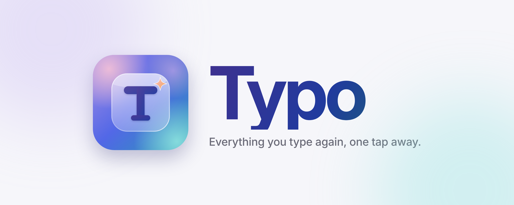</p>

# Typo

The fastest place to put things you'll need again. Save text, links, photos, GIFs and files from anywhere. Each saved item is one tap from your clipboard on iPhone, iPad and Mac, and from the Typo keyboard in any app.

Written 15 November 2026. **This code has not been compiled yet.** It was written in a Linux environment with no Xcode. It passes a Swift syntax check, but the first build on a Mac will almost certainly need small fixes. See "Status" below.

## Screens

These are **design mockups**, not simulator screenshots. They are drawn in HTML (`docs/mockups/mockups.html`) to match the layout, copy, hues and hue names in the SwiftUI code. Replace them with real screenshots once the app builds.

| Library (Recents) | Typo keyboard | Keyboard: Polish |
|---|---|---|
| 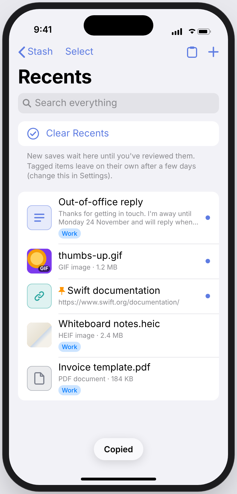 |  |  |

| Dictate and polish | Quick Save | Tag hue |
|---|---|---|
|  | 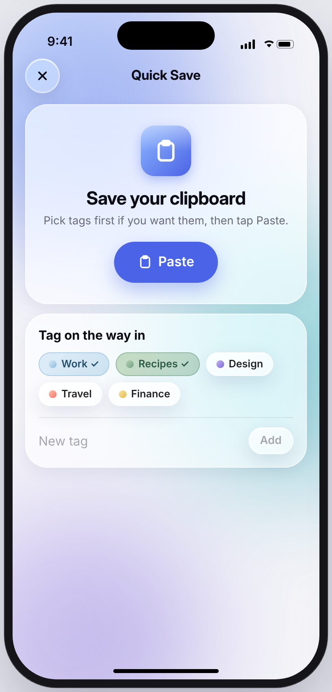 |  |

| Sync status | Collection board | QR studio |
|---|---|---|
| 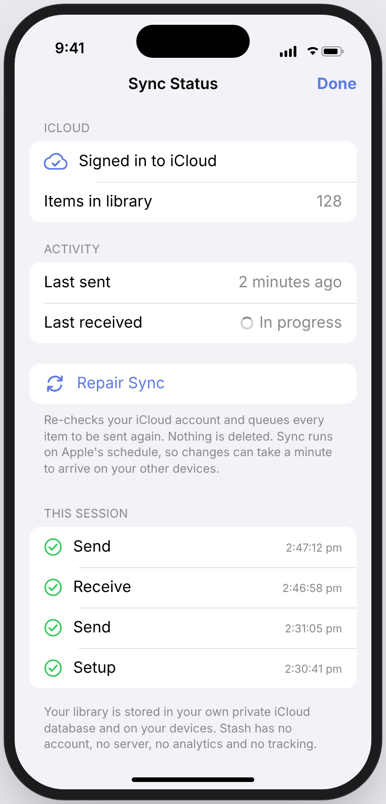 | 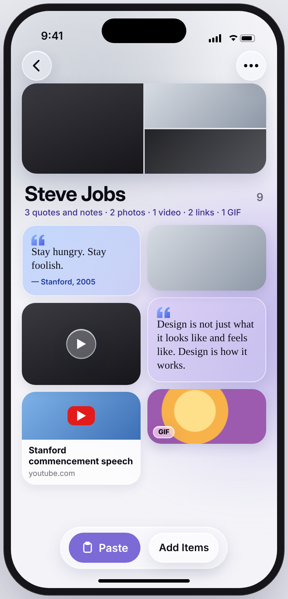 | 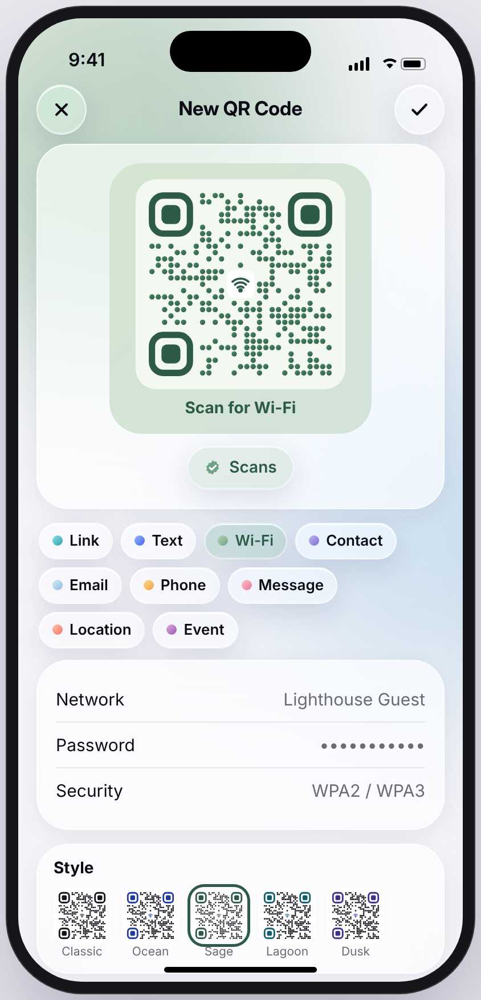 |

| Guest Wi-Fi | Scan anything | Card vault |
|---|---|---|
| 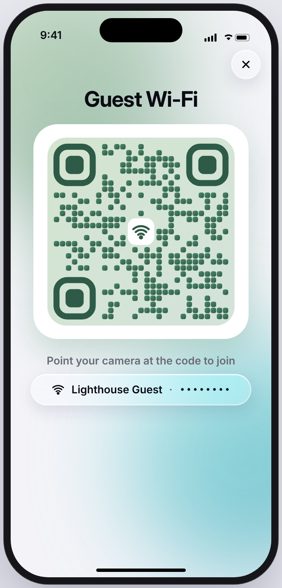 | 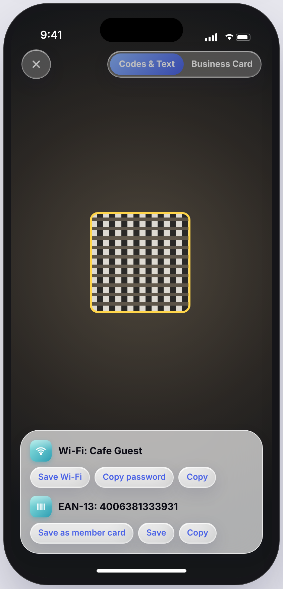 | 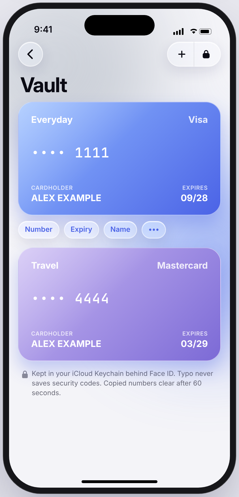 |

| Member card | Template fill-in | Text expansion |
|---|---|---|
| 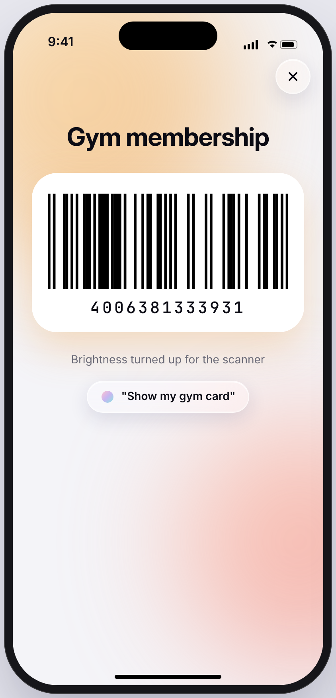 | 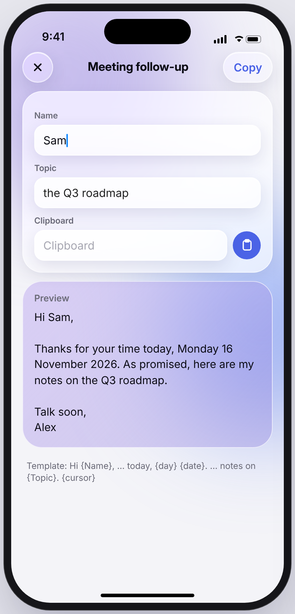 | 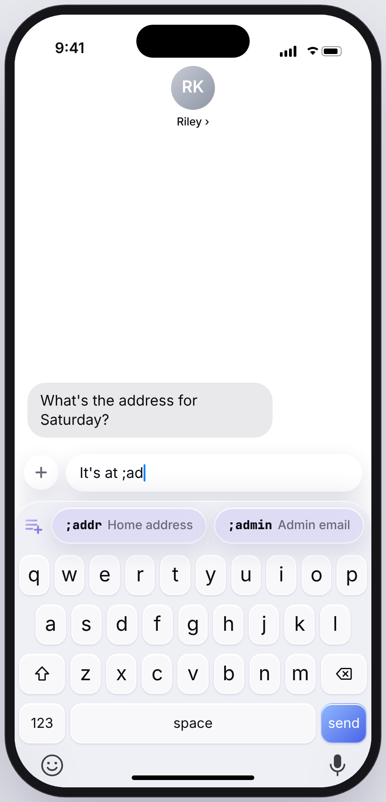 |

| Fill a template in the keyboard | Spotlight and Siri | |
|---|---|---|
| 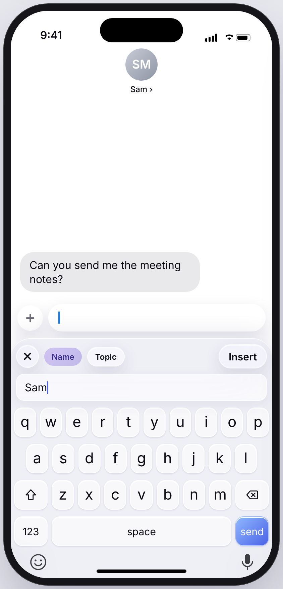 | 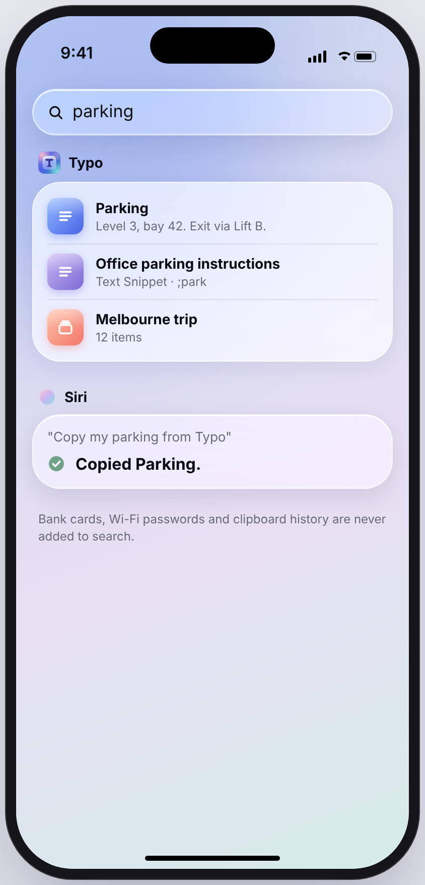 | |

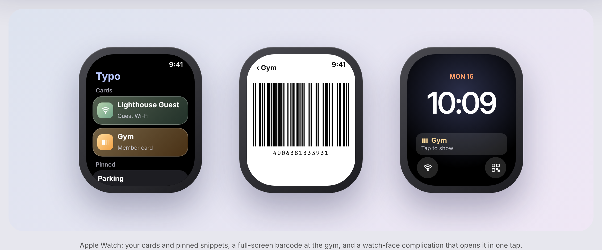

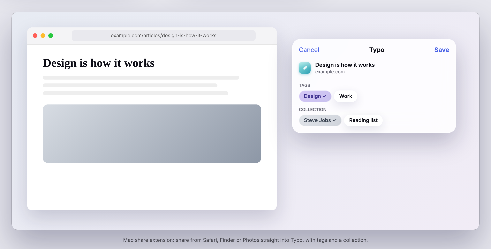

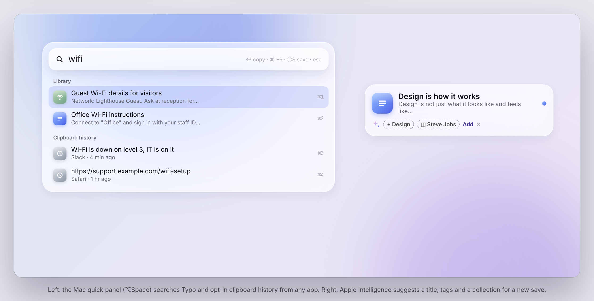

To re-render the screenshots after editing the mockups (Playwright and Chromium required):

```bash
node docs/mockups/render.js docs/mockups/mockups.html docs/screenshots 2
```

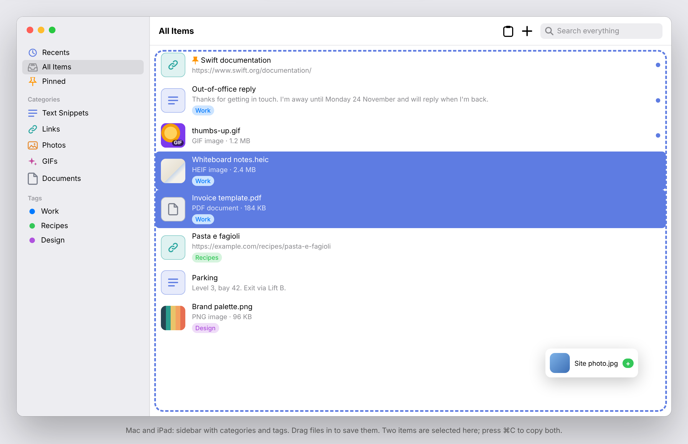

## Design

The design follows Apple's Liquid Glass guidance: **content sits on frosted material, and Liquid Glass is kept for the controls layer** that floats above it.

- **Liquid Glass (`glassEffect`, `GlassEffectContainer`, `.buttonStyle(.glass)`)** is used for the floating dock (Paste, Dictate, Quick Save, More), toasts, the keyboard's control strip and keycaps, polish-style chips, the dictation orb's ring, and secondary buttons. Toolbars and the sidebar pick up glass automatically on iOS 26 and macOS 26.
- **Frosted cards** (`.regularMaterial`) hold content: item rows, the transcript, and the settings and sync panels. Apple advises against glass in the content layer, and limiting the number of glass effects keeps scrolling smooth.
- **Ambient background:** a soft, blurred field of the current view's hues sits behind everything, giving the glass and material something to refract. It adapts to dark mode.
- **Gradient tiles:** categories use app-icon-style rounded tiles with a white symbol and a soft top highlight.

### Hues

Every category, tag and polish style uses one of twelve soothing two-stop gradients. Each has a one-word name, so people can remember and talk about them ("make Work Mist").

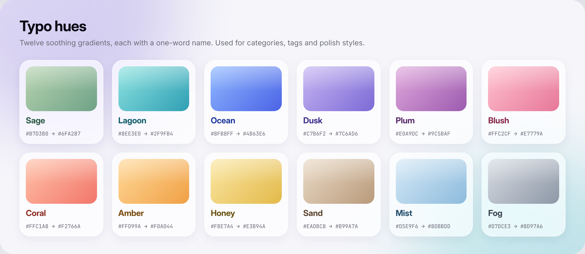

| Name | Gradient | Default use |
|---|---|---|
| Sage | `#B7D3B0` → `#6FA287` | Tidy up; first new tag |
| Lagoon | `#8EE3E0` → `#2F9FB4` | Links |
| Ocean | `#8FB8FF` → `#4B63E6` | Text Snippets; accent; Professional |
| Dusk | `#C7B6F2` → `#7C6AD6` | Dictate; AI prompt |
| Plum | `#E0A9DC` → `#9C5BAF` | |
| Blush | `#FFC2CF` → `#E7779A` | GIFs; Friendly |
| Coral | `#FFC1A8` → `#F2766A` | |
| Amber | `#FFD99A` → `#F0A044` | Photos; pins; Shorter |
| Honey | `#FBE7A4` → `#E3B94A` | |
| Sand | `#EADBC8` → `#B99A7A` | |
| Mist | `#D5E9F6` → `#8DBBDD` | |
| Fog | `#D7DCE3` → `#8D97A6` | Documents |

Each hue also has an "ink" colour, used for text on its pale gradient so that tag chips stay readable. In dark mode, chips switch to white text on the full gradient. The palette lives in `Shared/Design/Hue.swift`. Tags store the hue's **name**, so renaming or retuning a hue later doesn't break synced data.

### Logo

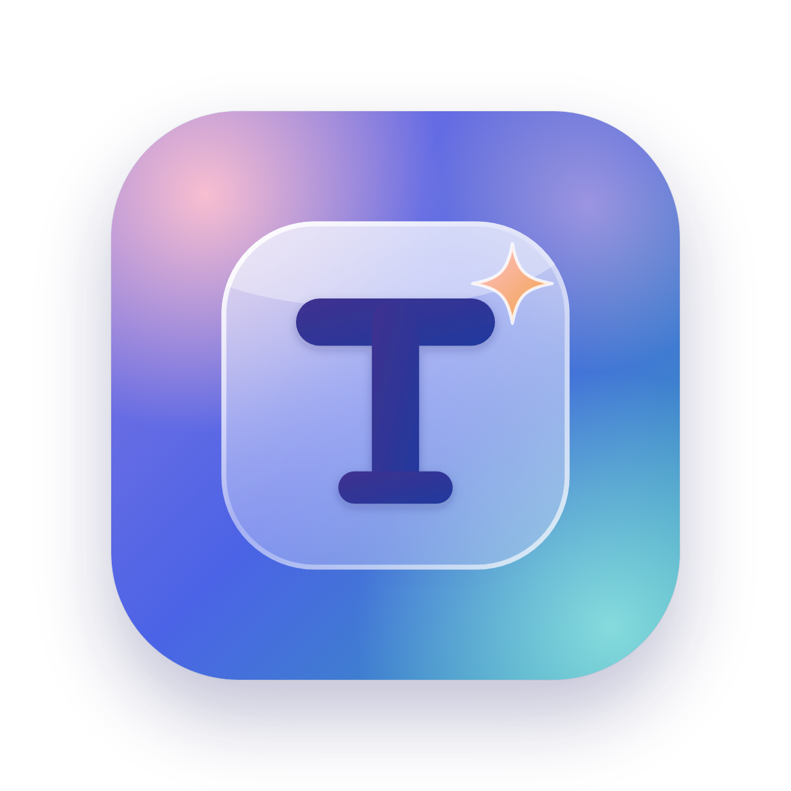

A frosted Liquid Glass keycap sits on a Dusk → Ocean → Lagoon aurora. On the keycap is a "T" whose stem is a text cursor, with an Amber-to-Blush sparkle for the on-device AI. The cursor makes it a keyboard; the sparkle makes it Polish.

- Source: `docs/brand/typo-icon.svg` (vector, 1024 × 1024, full bleed: iOS and macOS apply the rounded mask).
- In the app: `App/Assets.xcassets/AppIcon.appiconset` (opaque 1024 px, plus a 512 px Mac size).
- Lockups: `docs/brand/typo-lockup-light.png` and `typo-lockup-dark.png`. Size check: `docs/brand/typo-icon-sizes.png`.
- For full iOS 26 layered glass icons (with dark and tinted variants), rebuild it in Apple's Icon Composer from the SVG layers: background aurora, keycap, glyph, sparkle.

## Assumptions

- Minimum OS is **iOS/iPadOS 26 and macOS 26**. The on-device AI (Foundation Models framework) and the new speech API (`SpeechAnalyzer`) need them. Polish also needs an Apple Intelligence-capable device with Apple Intelligence turned on. Without it, the app hides Polish and explains why.
- `com.starconnect.typo` is a placeholder bundle ID. Check that "Typo" is available on the App Store, and have trade mark clearance done, before launch.
- Storage is SwiftData synced to the user's **private** CloudKit database. There is no server, account or analytics.

## Build

On a Mac with Xcode 26:

```bash
brew install xcodegen
```

```bash
cd Typo && xcodegen generate && open Typo.xcodeproj
```

Before you build for the first time:

1. In `project.yml`, set `BUNDLE_ID_PREFIX`, `APP_GROUP_ID`, `MAC_APP_GROUP_ID` and `ICLOUD_CONTAINER` to IDs you own, and set `DEVELOPMENT_TEAM`. Run `xcodegen generate` again after any edit.
2. In the Apple Developer portal (or let Xcode do it), create the App Group and the iCloud container, then enable them for the app and all its extensions:
   - **iOS:** keyboard, share, widgets.
   - **watchOS:** watch app, complications.
   - **Mac:** the Mac app group is prefixed with your Team ID, and it covers the Mac app and the Mac share extension.
   - **Also enable:** push notifications (CloudKit uses silent pushes), iCloud key-value storage (category hue sync), and keychain sharing (vault and Wi-Fi passwords).
3. Build the `Typo` scheme for iPhone/iPad (it embeds the Apple Watch app) and the `TypoMac` scheme for Mac (it embeds the Mac share extension). After generating, check that `TypoWatch` appears under the iOS target's "Embed Watch Content" build phase, because XcodeGen's handling of single-target watch apps varies between versions.
4. Before you ship, deploy the CloudKit schema to Production in the CloudKit Console. Development and Production use separate schemas.

## Feature map

| Requirement | Where | Notes |
|---|---|---|
| Share to Typo from any app, sorted automatically | `Share/ShareViewController.swift`, `Shared/Services/Ingest.swift` | Classification order: GIF, image, web link, file, text. A single http(s) URL in plain text becomes a Link. |
| Add from Clipboard with no "Allow Paste?" prompt | `PasteButton` in `LibraryView` and `QuickSaveView` | The system Paste button is the only supported way to avoid the prompt. |
| Drag onto the window on Mac or iPad | `.onDrop` in `ItemListView` | You can also drag items out to other apps. |
| Photo or GIF from a direct image URL | `Ingest.draft(fromImageURL:)`, Add menu | Checks the MIME type and the GIF magic bytes. |
| Save from Control Centre, Lock Screen or Action button, with tags | `Widgets/TypoWidgets.swift`, `OpenQuickSaveIntent` | Opens Quick Save: you tap Paste and pick tags. See limitations. |
| Shortcuts | `SaveToTypoIntent` | "Save to Typo" accepts text, links and files, plus tags. Tags that don't exist yet are created. |
| Tap to copy as the real thing | `Shared/Services/Clipboard.swift` | GIFs copy as `com.compuserve.gif`, so they stay animated. HEIC photos also get a PNG copy for apps that only accept PNG. |
| Multi-select copy | Select mode (iOS), ⌘-click (Mac) | |
| Quick Look | Context menu and item details | |
| Six categories (Videos added in round 2), named-hue tags, custom category hues | `ItemKind`, `Tag`, `Hues`, `SettingsView` | |
| Dictate, then AI rewrite | `App/Speech/Dictation.swift`, `Shared/AI/TextPolisher.swift`, `DictateView` | Five styles: Tidy up, Professional, Friendly, Shorter, AI prompt. Everything runs on the device. |
| Recents, clear in one tap, tagged items age out | `ItemListView`, `TypoLibrary.ageOutRecents()` | The age-out delay is set in Settings (default 3 days). |
| Pin, drag to reorder, search, rename | `ItemListView`, `ItemDetailView` | Link titles are fetched with `LPMetadataProvider` and never overwrite a name you set. |
| Private iCloud sync with a status screen and repair | `TypoStore`, `App/SyncMonitor.swift`, `SyncStatusView` | |
| Keyboard | `Keyboard/` | A library tab (with category and collection chips), a basic ABC typing tab, and Polish. |
| **Collections** (mixed folders, e.g. "Steve Jobs": quotes, photos, videos, a YouTube speech, articles, GIFs) | `TypoCollection`, `CollectionLibrary`, `App/Views/Collections/` | Shown as a board: quotes become cards, photos and video posters become tiles, links show their preview image (YouTube gets a play badge). An item can be in several collections. Add by paste, drag and drop, "Add Items", the share sheet, Quick Save, Dictate or an item's context menu. Manual order, cover, and export as a zip with a `Notes.md`. |
| Videos category | `ItemKind.video`, `TypoLibrary.makeVideoThumbnail` | A sixth category so videos no longer land in Documents. The poster frame comes from about one second in. |
| QR studio and guest Wi-Fi | `Shared/Codes/`, `App/Views/Codes/` | Link, text, Wi-Fi, contact, email, phone, message, location and event codes. Decorate with dot and eye shapes, a hue, a centre badge and a caption, then check it still scans (Vision). Present full screen with the brightness up. Share as PNG. Show on the Home Screen or StandBy widget. |
| Scan anything | `App/Views/Scan/` | VisionKit live scanner (iPhone and iPad): QR codes, barcodes, printed text and business cards, each routed to the right action. QR codes found inside saved photos are offered too (Mac as well). |
| Card vault | `Shared/Vault/`, `App/Views/Vault/` | Face ID or passcode, iCloud Keychain, no CVV field, masked numbers, copies that clear after 60 seconds and don't reach other devices. Camera scanning reads the number, expiry and name only. |
| Member and loyalty cards | `CodeItem` (member), `CodesView`, `ShowCodeIntent` | Code 128, EAN-13, UPC-A, PDF417, Aztec and QR. Checkout view with brightness up. "Show my gym card" with Siri. |
| AI assistant | `App/AI/SaveAssistant.swift`, `DataActions` | On-device suggestions for title, tags, collection and summary. Text in photos becomes searchable. Addresses, phone numbers, links and dates become one-tap actions. |
| **Templates** | `Shared/Services/Template.swift`, `FillTemplateView` | `{date}` (16 November 2026), `{shortdate}`, `{time}`, `{day}`, `{cursor}`, `{clipboard}` and fill-in fields such as `{Name}` or `{Name=default}`. Copying a template with fields opens a fill-in sheet with a live preview; without fields it copies rendered. `{{` and `}}` give literal braces. |
| **Text expansion** | `TextExpander`, `KeyboardActions`, `ItemDetailView` | Give any snippet a shortcut such as `;addr`. Typing it plus a space or punctuation with the Typo keyboard replaces it, and a suggestion strip appears while you type. A template with fields opens a fill panel inside the keyboard, typed with the Typo keys, and Insert moves the cursor to `{cursor}`. The Mac quick panel finds shortcuts too. |
| **Spotlight** | `Shared/Intents/TypoEntities.swift`, `App/Spotlight/SpotlightSync.swift` | Items, collections and code names are indexed with `IndexedEntity` in a named index. Tapping a result opens it in Typo. There's a toggle and a "Rebuild Search Index" button in Settings. |
| **Siri and Shortcuts** | `Shared/Intents/CopyIntents.swift`, `TypoShortcuts` | "Copy \<item\> from Typo", "Copy my \<network\> password with Typo" (from the Keychain, cleared after 60 s, never spoken), "Open my \<collection\> collection in Typo", plus Quick Save, Save to Typo and Show Code. |
| **Apple Watch** | `Watch/`, `WatchWidgets/`, `App/Watch/WatchSync.swift`, `Shared/Watch/WatchPack.swift` | Codes marked "Show on Apple Watch" (member cards, guest Wi-Fi) are rendered on the iPhone and sent with WatchConnectivity. Pinned snippets are sent for reading. A watch-face complication and Smart Stack widget open a chosen card. |
| **Mac share extension** | `MacShare/`, `Share/ShareView.swift` | The same share sheet as iOS, with tags and collections, from Safari, Finder, Photos or any app's Share menu. |
| **Category hue sync** | `App/Sync/HueSync.swift` | Category hues follow you between iPhone, iPad and Mac through iCloud key-value storage. |
| Mac quick panel and clipboard history | `App/Mac/` | ⌥Space (configurable) opens a floating search panel from any app. A menu bar icon opens it too. Clipboard history is opt-in, local only, 200 items or 7 days, and skips content marked private by password managers. |

## Architecture

```
App/        SwiftUI app (iOS + macOS): library, quick save, dictation, sync, settings
Keyboard/   Custom keyboard extension (iOS)
Share/      Share extension (iOS)
Widgets/    Control Centre control, Lock Screen widget, code widget (iOS)
Shared/     Model, store, ingest/classify, clipboard, AI polish, App Intents,
            Codes/ (QR and barcode engine), Vault/ (Keychain, card logic)
Tests/      Unit tests (Swift Testing), hosted in the Mac app
Config/     Info.plists and entitlements
```

How each process uses the store:

- **App**: owns the SwiftData store and runs CloudKit sync.
- **Keyboard**: opens the same store **read-only** with no CloudKit. Sync never runs inside the keyboard's small memory budget, and the keyboard shows only thumbnails, never full files.
- **Secrets** (card numbers and Wi-Fi passwords) never go into SwiftData or CloudKit. They live in the iCloud Keychain, and `CodeItem` stores only a Keychain reference. `Shared/Vault` and `Shared/Codes` are excluded from the keyboard and share extension targets.
- **Share extension**: never writes to the store. It writes each save to an inbox folder in the App Group and pings the app with a Darwin notification. The app imports from the inbox at launch, when it becomes active, and when it receives the ping. This avoids two processes mirroring one store to CloudKit.

## Limitations

These are platform constraints, not gaps in this code.

1. **No microphone in the keyboard.** iOS does not give keyboard extensions microphone access, even with Full Access. Dictation therefore lives in the app. The keyboard's Polish button rewrites the selected text, or the text before the cursor. That text can come from Apple's own dictation key, where the device shows one. Other apps work around this by jumping to their app to record, but developers report that returning to the original app broke on iOS 26.4 and later. I left that workaround out.
2. **Keyboard Polish only sees nearby text.** iOS exposes only the text around the cursor to keyboards. To polish a long passage, select it first.
3. **Images can't be typed in.** A keyboard can only insert text. Photos, GIFs and files are copied, and the user then pastes. Copying needs Full Access.
4. **Control Centre and Action button open Quick Save; they don't save silently.** Reading the clipboard in the background isn't allowed, and a programmatic read in the foreground shows the paste prompt. For a fully silent, prompt-free save, the user can build a Shortcut ("Get Clipboard" then "Save to Typo") and assign it to the Action button. Shortcuts handles clipboard permission itself.
5. **Sync timing is up to Apple.** No API forces a sync or reports per-item sync state. The status screen shows the last completed send and receive, the iCloud account state and the last error. Repair re-queues every item for upload; it deletes nothing.
6. **Large files.** Extensions are capped at 50 MB per item and the app at 250 MB. The keyboard won't copy files over 20 MB. All of these are memory-safety limits.
7. **No Mac share extension yet.** On Mac you can save by paste, drag and drop, ⌘⇧V, file import and Shortcuts.
8. **Vault Face ID is enforced by Typo, not by the Keychain item itself.** iCloud Keychain can't sync items that demand biometrics at the OS level. Cards are still encrypted by the device Keychain and only readable while the device is unlocked. Typo adds the Face ID or passcode gate, and relocks 60 seconds after leaving the app.
9. **Face ID can't be used inside the keyboard**, so the vault is never shown there.
10. **No live scanner on Mac.** VisionKit's live scanner is iPhone and iPad only. On Mac, Typo finds codes in images you drop or paste.
11. **The Wi-Fi QR format has no formal standard.** Typo follows the ZXing reference that camera apps use, with `\ ; , : "` escaped. Test with both an iPhone and an Android phone.
12. **No Lock Screen code widget.** iOS tints Lock Screen widgets, which can stop a QR code scanning. The code widget is Home Screen and StandBy only.
13. **The Mac quick panel copies but doesn't paste for you.** Sandboxed apps can't send keystrokes, so after the panel closes you press ⌘V.
14. **Text expansion works only in the Typo keyboard.** iOS doesn't let apps add to the system Text Replacements, and system-wide expansion on Mac would need Accessibility keystroke access, which doesn't fit the sandbox.
15. **`{clipboard}` in templates:** on iPhone and iPad, reading the clipboard would show the "Allow Paste?" prompt, so `{clipboard}` becomes a field with a Paste button. On Mac it fills in automatically.
16. **Apple Watch:**
    - The watch has no clipboard, so snippets on the watch are for reading.
    - Brightness can't be raised from an app, and some laser barcode scanners struggle with watch screens. QR readers are usually fine.
    - The watch shows what the iPhone last sent.
17. **Siri copying in the background is unverified.** Whether an App Intent can write to the clipboard while the app isn't on screen isn't documented, and reports conflict. The copy intents also return the text, so a Shortcut can add its own "Copy to Clipboard" step if needed.

## Status: verified vs inferred

Checked against Apple's documentation in November 2026:
- `LanguageModelSession(instructions:)`, `respond(to:)` and `.content` (Foundation Models, iOS/macOS 26+).
- The `SpeechAnalyzer` / `SpeechTranscriber` / `AssetInventory` flow and `AnalyzerInput`.
- `NSPersistentCloudKitContainer.eventChangedNotification` as the way to observe SwiftData's CloudKit activity.
- Liquid Glass: `glassEffect(_:in:)`, `Glass.regular.tint(_:).interactive()`, `GlassEffectContainer(spacing:)`, `.buttonStyle(.glass)`.
- VisionKit `DataScannerViewController` (iOS 16+, `isSupported`/`isAvailable`, `RecognizedItem.barcode/.text`).
- Vision `DetectBarcodesRequest` and `RecognizeTextRequest` (iOS 18 / macOS 15+, `perform(on:)`).
- CoreImage `CIFilter.qrCodeGenerator()` with `message` and `correctionLevel`.
- Foundation Models guided generation: `@Generable`, `@Guide(description:)`, `respond(to:generating:)`.
- `IndexedEntity` (iOS 18 / macOS 15+) with `attributeSet` and `hideInSpotlight`, `CSSearchableIndex(name:).indexAppEntities(_:)`, `IndexedEntityQuery` reindex methods, and `OpenIntent` with a `target` parameter for opening search results.
- WatchConnectivity: `WCSession.activate()`, `updateApplicationContext(_:)`, `transferFile(_:metadata:)`, `isPaired`, `isWatchAppInstalled`, and the multi-watch activation callbacks.
- `CIFilter` isn't available on watchOS, which is why the iPhone renders codes for the watch.

Inferred and needing on-device testing:
- That the Foundation Models API works inside a keyboard extension. An Apple engineer said the system model doesn't count toward an extension's memory limit, but that was about a different extension type.
- That SwiftData still posts the CloudKit event notifications in iOS 26.
- That opening the store read-only from the keyboard while the app syncs causes no history-tracking warnings.
- The exact case names of `SystemLanguageModel.Availability.UnavailableReason`.
- `BarcodeObservation.payloadString`, `RecognizedTextObservation.topCandidates(_:)` and `RecognizedItem.Barcode.payloadStringValue` property names.
- That CoreImage has no EAN-13 generator (Typo encodes EAN-13 and UPC-A itself either way).
- That `NSFileCoordinator`'s `.forUploading` option zips a folder on iOS (used for collection export).
- That the bitmap read in `CodeGenerator.read` comes out top row first. If not, codes render mirrored, and the "presets scan" tests will fail.
- That `CNContactViewController(forNewContact:)` works without asking for Contacts access.
- That an App Intent run by Siri in the background can write to the clipboard.
- That `UITextDocumentProxy.adjustTextPosition(byCharacterOffset:)` counts characters as Swift does. Typo counts `Character`s; emoji after `{cursor}` could leave the cursor slightly off.
- XcodeGen embedding of the single-target watch app, and `DisplayRepresentation.Image(data:)` for Spotlight thumbnails.
- Everything that only a compiler can confirm. Start with `Dictation.swift`, `SaveToTypoIntent.swift` and the toolbar in `LibraryView.swift`.

## Privacy

- No analytics, tracking, accounts or third-party SDKs.
- Network use: CloudKit (the user's own iCloud), link title fetches (a request to the saved link's own site), and image downloads when the user saves an image URL.
- AI and speech run entirely on the device.
- **Card vault:** card details stay in the user's iCloud Keychain. Typo has no field for the security code. Numbers are masked until unlocked, copies expire after 60 seconds and are kept off Universal Clipboard. On Mac, copies are marked concealed so clipboard managers skip them.
- **Camera:** used only while scanning. Images are read on the device and are not kept unless the user saves the result.
- **Clipboard history (Mac):** off by default, never synced, deleted after 7 days, and skips content marked concealed or transient by password managers.
- **Guest Wi-Fi codes** contain the network password by design. The widget image lives in the App Group container on the device.
- **Spotlight:** snippet text (first 300 characters), titles, tags, collection names and code names are added to the on-device index. Payment cards, Wi-Fi passwords, member numbers and clipboard history are not. Turning Spotlight off in Settings removes everything.
- **Apple Watch:** only codes you mark "Show on Apple Watch", and optionally pinned snippets, are sent, directly from iPhone to watch. A guest Wi-Fi code image contains the password by design.
- **Payment cards and PCI DSS (not legal advice):** the developer never receives card data. Even so, have a qualified adviser confirm the position, and the App Store privacy label, before launch.
- The keyboard requests Full Access only so it can read the shared library and copy files. It makes no network calls and stores nothing the user types. Say this plainly on the App Store listing and in the keyboard setup screen.
- iCloud data is stored by Apple under the user's Apple Account, so the developer holds no user data. Before release, have a privacy professional review the App Store privacy label and your privacy policy against the Australian Privacy Principles.

## Tests

`Tests/` holds Swift Testing suites, run on the Mac app with ⌘U on the `TypoMac` scheme:
- Wi-Fi escaping and round trips (including `\ ; , : "`), vCard escaping, scanned-payload classification, and keeping the Wi-Fi password out of stored data.
- Luhn checks against the networks' public test numbers, network detection, formatting, masking, expiry parsing, and reading OCR lines while ignoring the CVV.
- EAN-13 and UPC-A check digits and patterns, QR matrix shape, and **every style preset rendered and then decoded by Vision**.
- Collection ordering, counts, and that removing an item from a collection keeps it in the library.
- Templates: fields in order, defaults, `{cursor}` offset, Australian date and time formats, literal braces, and `{clipboard}` handling.
- Text expansion: `;addr` followed by a space, full stop or new line; no match mid-word or for unknown shortcuts; suggestions while typing.
- Apple Watch pack: encoding round trip and the 25-snippet cap.

Manual checks on devices:
1. Scan a guest Wi-Fi QR with the iPhone Camera app and with an Android phone, then join. Repeat with a password containing `;` and `:`.
2. Vault: needs Face ID, relocks after backgrounding, cards absent from keyboard, widgets, search and Mac history. A copied number disappears after 60 s and doesn't reach the Mac.
3. Scan a QR code, an EAN barcode, printed text and a business card.
4. Build a collection from the share sheet (Safari link, Photos image, a video, a YouTube link) and check the board, the cover and the zip export.
5. Mac: ⌥Space opens the panel from any app. History stays off until turned on. A password copied from the Passwords app does not appear in it.
6. Keyboard: in Notes, type `;addr` and a space with the Typo keyboard. A template with `{Name}` opens the fill panel, and Insert leaves the cursor at `{cursor}`.
7. Spotlight: search a snippet's words on iPhone and Mac, and tap the result to open it. Vault cards never appear. Turning Spotlight off removes Typo's results.
8. Siri: "Copy my parking from Typo" with Typo open and from the Lock Screen. Note whether the background copy works.
9. Apple Watch: mark a gym card "Show on Apple Watch"; it arrives on the watch, scans, and the complication opens it.
10. Mac share: share a Safari page into a collection. Change a category hue on iPhone and check the Mac picks it up.

## Next steps

1. Get it compiling on Xcode 26, then test on an iPhone with Apple Intelligence turned on and a paired Apple Watch.
2. Shared collections with family or a team. CloudKit sharing needs Core Data rather than SwiftData, so this is a storage migration.
3. Rebuild the app icon in Icon Composer for layered Liquid Glass icons (dark and tinted variants).
4. Move to Swift 6 language mode.
