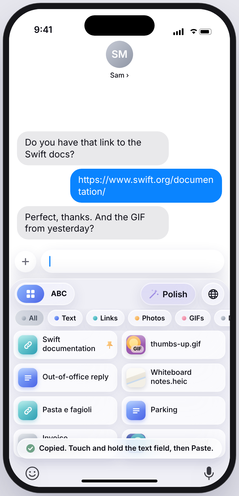
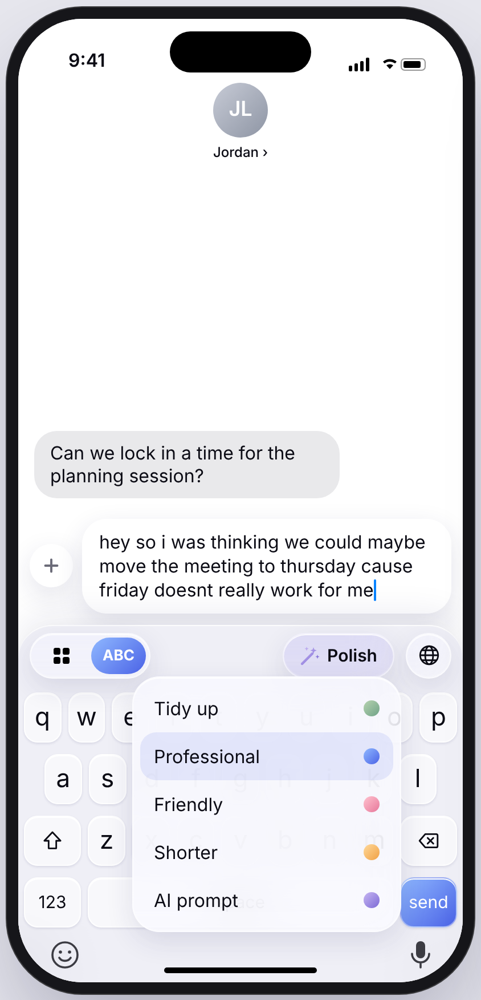
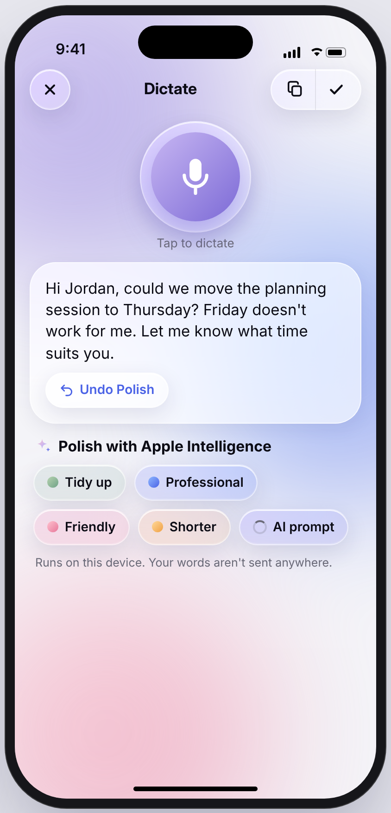
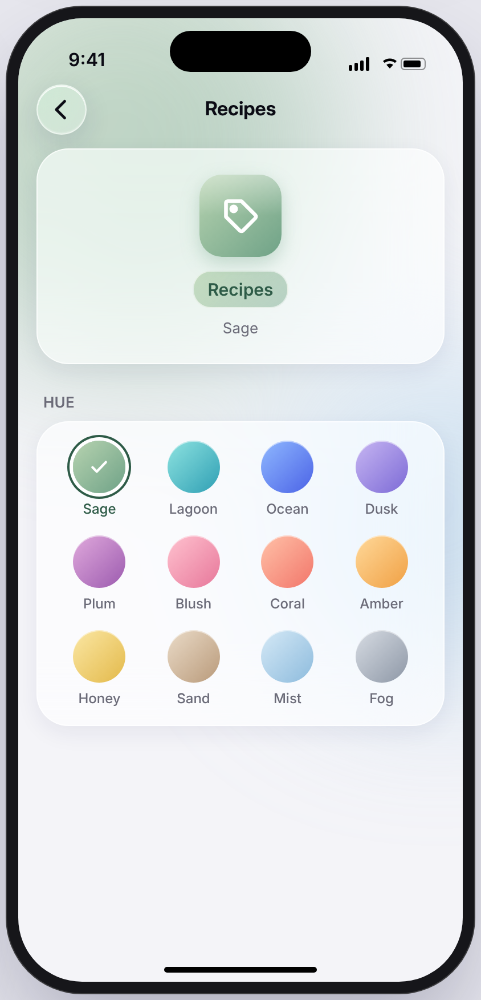

<p align="center"></p>

# Typo

The fastest place to put things you'll need again. Save text, links, photos, GIFs and files from anywhere. Each saved item is one tap from your clipboard on iPhone, iPad and Mac, and from the Typo keyboard in any app.

Written 15 November 2026. **This code has not been compiled yet.** It was written in a Linux environment with no Xcode. It passes a Swift syntax check, but the first build on a Mac will almost certainly need small fixes. See "Status" below.

## Screens

These are **design mockups**, not simulator screenshots. They are drawn in HTML (`docs/mockups/mockups.html`) to match the layout, copy, hues and hue names in the SwiftUI code. Replace them with real screenshots once the app builds.

| Library (Recents) | Typo keyboard | Keyboard: Polish |
|---|---|---|
|  |  |  |

| Dictate and polish | Quick Save | Tag hue |
|---|---|---|
|  |  |  |

| Sync status | |
|---|---|
|  | |


## Design

The design follows Apple's Liquid Glass guidance: **content sits on frosted material, and Liquid Glass is kept for the controls layer** that floats above it.

- **Liquid Glass (`glassEffect`, `GlassEffectContainer`, `.buttonStyle(.glass)`)** is used for the floating dock (Paste, Dictate, Quick Save, More), toasts, the keyboard's control strip and keycaps, polish-style chips, the dictation orb's ring, and secondary buttons. Toolbars and the sidebar pick up glass automatically on iOS 26 and macOS 26.
- **Frosted cards** (`.regularMaterial`) hold content: item rows, the transcript, and the settings and sync panels. Apple advises against glass in the content layer, and limiting the number of glass effects keeps scrolling smooth.
- **Ambient background:** a soft, blurred field of the current view's hues sits behind everything, giving the glass and material something to refract. It adapts to dark mode.
- **Gradient tiles:** categories use app-icon-style rounded tiles with a white symbol and a soft top highlight.

### Hues

Every category, tag and polish style uses one of twelve soothing two-stop gradients. Each has a one-word name, so people can remember and talk about them ("make Work Mist").


| Name | Gradient | Default use |
|---|---|---|
| Sage | `#B7D3B0` → `#6FA287` | Tidy up; first new tag |
| Lagoon | `#8EE3E0` → `#2F9FB4` | Links |
| Ocean | `#8FB8FF` → `#4B63E6` | Text Snippets; accent; Professional |
| Dusk | `#C7B6F2` → `#7C6AD6` | Dictate; AI prompt |
| Plum | `#E0A9DC` → `#9C5BAF` | |
| Blush | `#FFC2CF` → `#E7779A` | GIFs; Friendly |
| Coral | `#FFC1A8` → `#F2766A` | |
| Amber | `#FFD99A` → `#F0A044` | Photos; pins; Shorter |
| Honey | `#FBE7A4` → `#E3B94A` | |
| Sand | `#EADBC8` → `#B99A7A` | |
| Mist | `#D5E9F6` → `#8DBBDD` | |
| Fog | `#D7DCE3` → `#8D97A6` | Documents |

Each hue also has an "ink" colour, used for text on its pale gradient so that tag chips stay readable. In dark mode, chips switch to white text on the full gradient. The palette lives in `Shared/Design/Hue.swift`. Tags store the hue's **name**, so renaming or retuning a hue later doesn't break synced data.

### Logo


A frosted Liquid Glass keycap sits on a Dusk → Ocean → Lagoon aurora. On the keycap is a "T" whose stem is a text cursor, with an Amber-to-Blush sparkle for the on-device AI. The cursor makes it a keyboard; the sparkle makes it Polish.

- Source: `docs/brand/typo-icon.svg` (vector, 1024 × 1024, full bleed: iOS and macOS apply the rounded mask).
- In the app: `App/Assets.xcassets/AppIcon.appiconset` (opaque 1024 px, plus a 512 px Mac size).
- Lockups: `docs/brand/typo-lockup-light.png` and `typo-lockup-dark.png`. Size check: `docs/brand/typo-icon-sizes.png`.
- For full iOS 26 layered glass icons (with dark and tinted variants), rebuild it in Apple's Icon Composer from the SVG layers: background aurora, keycap, glyph, sparkle.

## Assumptions

- Minimum OS is **iOS/iPadOS 26 and macOS 26**. The on-device AI (Foundation Models framework) and the new speech API (`SpeechAnalyzer`) need them. Polish also needs an Apple Intelligence-capable device with Apple Intelligence turned on. Without it, the app hides Polish and explains why.
- `com.starconnect.typo` is a placeholder bundle ID. Check that "Typo" is available on the App Store, and have trade mark clearance done, before launch.
- Storage is SwiftData synced to the user's **private** CloudKit database. There is no server, account or analytics.

## Build

On a Mac with Xcode 26:

```bash
brew install xcodegen
```

```bash
cd Typo && xcodegen generate && open Typo.xcodeproj
```

Before you build for the first time:

1. In `project.yml`, set `BUNDLE_ID_PREFIX`, `APP_GROUP_ID` and `ICLOUD_CONTAINER` to IDs you own, and set `DEVELOPMENT_TEAM`. Run `xcodegen generate` again after any edit.
2. In the Apple Developer portal (or let Xcode do it), create the App Group and the iCloud container, then enable them for the app and all three extensions. Push notifications must be on for the app, because CloudKit uses silent pushes.
3. Build the `Typo` scheme for iPhone/iPad and the `TypoMac` scheme for Mac.
4. Before you ship, deploy the CloudKit schema to Production in the CloudKit Console. Development and Production use separate schemas.

## Feature map

| Requirement | Where | Notes |
|---|---|---|
| Share to Typo from any app, sorted automatically | `Share/ShareViewController.swift`, `Shared/Services/Ingest.swift` | Classification order: GIF, image, web link, file, text. A single http(s) URL in plain text becomes a Link. |
| Add from Clipboard with no "Allow Paste?" prompt | `PasteButton` in `LibraryView` and `QuickSaveView` | The system Paste button is the only supported way to avoid the prompt. |
| Drag onto the window on Mac or iPad | `.onDrop` in `ItemListView` | You can also drag items out to other apps. |
| Photo or GIF from a direct image URL | `Ingest.draft(fromImageURL:)`, Add menu | Checks the MIME type and the GIF magic bytes. |
| Save from Control Centre, Lock Screen or Action button, with tags | `Widgets/TypoWidgets.swift`, `OpenQuickSaveIntent` | Opens Quick Save: you tap Paste and pick tags. See limitations. |
| Shortcuts | `SaveToTypoIntent` | "Save to Typo" accepts text, links and files, plus tags. Tags that don't exist yet are created. |
| Tap to copy as the real thing | `Shared/Services/Clipboard.swift` | GIFs copy as `com.compuserve.gif`, so they stay animated. HEIC photos also get a PNG copy for apps that only accept PNG. |
| Multi-select copy | Select mode (iOS), ⌘-click (Mac) | |
| Quick Look | Context menu and item details | |
| Five categories, coloured tags, custom category colours | `ItemKind`, `Tag`, `SettingsView` | |
| Dictate, then AI rewrite | `App/Speech/Dictation.swift`, `Shared/AI/TextPolisher.swift`, `DictateView` | Five styles: Tidy up, Professional, Friendly, Shorter, AI prompt. Everything runs on the device. |
| Recents, clear in one tap, tagged items age out | `ItemListView`, `TypoLibrary.ageOutRecents()` | The age-out delay is set in Settings (default 3 days). |
| Pin, drag to reorder, search, rename | `ItemListView`, `ItemDetailView` | Link titles are fetched with `LPMetadataProvider` and never overwrite a name you set. |
| Private iCloud sync with a status screen and repair | `TypoStore`, `App/SyncMonitor.swift`, `SyncStatusView` | |
| Keyboard | `Keyboard/` | A library tab, a basic ABC typing tab, and Polish. |

## Architecture

```
App/        SwiftUI app (iOS + macOS): library, quick save, dictation, sync, settings
Keyboard/   Custom keyboard extension (iOS)
Share/      Share extension (iOS)
Widgets/    Control Centre control + Lock Screen widget (iOS)
Shared/     Model, store, ingest/classify, clipboard, AI polish, App Intents
Config/     Info.plists and entitlements
```

How each process uses the store:

- **App**: owns the SwiftData store and runs CloudKit sync.
- **Keyboard**: opens the same store **read-only** with no CloudKit. Sync never runs inside the keyboard's small memory budget, and the keyboard shows only thumbnails, never full files.
- **Share extension**: never writes to the store. It writes each save to an inbox folder in the App Group and pings the app with a Darwin notification. The app imports from the inbox at launch, when it becomes active, and when it receives the ping. This avoids two processes mirroring one store to CloudKit.

## Limitations

These are platform constraints, not gaps in this code.

1. **No microphone in the keyboard.** iOS does not give keyboard extensions microphone access, even with Full Access. Dictation therefore lives in the app. The keyboard's Polish button rewrites the selected text, or the text before the cursor. That text can come from Apple's own dictation key, where the device shows one. Other apps work around this by jumping to their app to record, but developers report that returning to the original app broke on iOS 26.4 and later. I left that workaround out.
2. **Keyboard Polish only sees nearby text.** iOS exposes only the text around the cursor to keyboards. To polish a long passage, select it first.
3. **Images can't be typed in.** A keyboard can only insert text. Photos, GIFs and files are copied, and the user then pastes. Copying needs Full Access.
4. **Control Centre and Action button open Quick Save; they don't save silently.** Reading the clipboard in the background isn't allowed, and a programmatic read in the foreground shows the paste prompt. For a fully silent, prompt-free save, the user can build a Shortcut ("Get Clipboard" then "Save to Typo") and assign it to the Action button. Shortcuts handles clipboard permission itself.
5. **Sync timing is up to Apple.** No API forces a sync or reports per-item sync state. The status screen shows the last completed send and receive, the iCloud account state and the last error. Repair re-queues every item for upload; it deletes nothing.
6. **Large files.** Extensions are capped at 50 MB per item and the app at 250 MB. The keyboard won't copy files over 20 MB. All of these are memory-safety limits.
7. **No Mac share extension yet.** On Mac you can save by paste, drag and drop, ⌘⇧V, file import and Shortcuts.

## Status: verified vs inferred

Checked against Apple's documentation in November 2026:
- `LanguageModelSession(instructions:)`, `respond(to:)` and `.content` (Foundation Models, iOS/macOS 26+).
- The `SpeechAnalyzer` / `SpeechTranscriber` / `AssetInventory` flow and `AnalyzerInput`.
- `NSPersistentCloudKitContainer.eventChangedNotification` as the way to observe SwiftData's CloudKit activity.

Inferred and needing on-device testing:
- That the Foundation Models API works inside a keyboard extension. An Apple engineer said the system model doesn't count toward an extension's memory limit, but that was about a different extension type.
- That SwiftData still posts the CloudKit event notifications in iOS 26.
- That opening the store read-only from the keyboard while the app syncs causes no history-tracking warnings.
- The exact case names of `SystemLanguageModel.Availability.UnavailableReason`.
- Everything that only a compiler can confirm. Start with `Dictation.swift`, `SaveToTypoIntent.swift` and the toolbar in `LibraryView.swift`.

## Privacy

- No analytics, tracking, accounts or third-party SDKs.
- Network use: CloudKit (the user's own iCloud), link title fetches (a request to the saved link's own site), and image downloads when the user saves an image URL.
- AI and speech run entirely on the device.
- The keyboard requests Full Access only so it can read the shared library and copy files. It makes no network calls and stores nothing the user types. Say this plainly on the App Store listing and in the keyboard setup screen.
- iCloud data is stored by Apple under the user's Apple Account, so the developer holds no user data. Before release, have a privacy professional review the App Store privacy label and your privacy policy against the Australian Privacy Principles.

## Next steps

1. Get it compiling on Xcode 26, then test on an iPhone with Apple Intelligence turned on.
2. Add a Mac share extension.
3. Sync category colours through `NSUbiquitousKeyValueStore`. They are currently stored per device.
4. Add unit tests for `Ingest` classification and for the `TypoLibrary` reorder and age-out logic.
5. Move to Swift 6 language mode.
